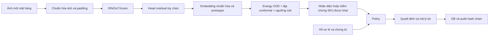

# Kiến trúc model và ứng dụng

## Luồng xử lý

DINOv2 ViT-S/14 là backbone mặc định. Ảnh được xử lý EXIF, đổi RGB và resize
giữ tỷ lệ với padding 224. `crop`/`stretch` dùng cho ablation. Head residual
học bằng episodic prototypical loss trên known-train; validation chọn head.
Backbone không cập nhật tham số. Với head 384 chiều tương ứng ViT-S/14, khởi
tạo giữ biểu diễn gần backbone ban đầu.

Mỗi SKU có một hoặc nhiều prototype. Nhận diện trả tập ứng viên cùng trạng
thái; tập rỗng thể hiện từ chối. Verifier kiểm tra riêng SKU mà người dùng
khai. Conformal calibration dùng dữ liệu hiệu chỉnh tách biệt; p-value không
phải xác suất sản phẩm đúng. Khi thiếu calibration phù hợp, hệ thống yêu cầu
xác nhận thay vì tự coi kết quả là chắc chắn.

Calibration mới còn lưu Energy từ logits −distance² và ngưỡng selective
risk chọn bằng known-calibration. OOD có thể từ chối dù khoảng cách vẫn
trong bán kính conformal; risk gate có thể yêu cầu nhân viên dù tập chỉ có
một ứng viên. Verifier dùng chung các gate này để lời khai SKU không đi
vòng qua cơ chế từ chối. Công thức và giới hạn thống kê:
[đối chiếu nhận xét](REVIEW_CHANGES.md).

## Mã nguồn theo trách nhiệm

| Module | Trách nhiệm |
|---|---|
| `rpv/data/` | Nhập dữ liệu thật, manifest, nhóm ảnh và split |
| `rpv/vision/encoders.py`, `projection.py` | Backbone, preprocessing, head và train |
| `rpv/vision/cache.py`, `prototypes.py` | Cache embedding và danh mục prototype |
| `rpv/vision/calibration.py`, `recognizer.py`, `verification.py` | Ngưỡng, nhận diện, kiểm chứng |
| `rpv/services/enrollment.py` | Hồ sơ đăng ký, chất lượng ảnh, nhầm lẫn, lịch sử kiểm tra |
| `rpv/services/checkout.py` | Phối hợp thị giác, hồ sơ, policy, xuất bản SKU và audit |
| `rpv/domain/`, `rpv/provenance/` | SKU/lô/chứng từ, SQLite và luật quyết định |
| `rpv/audit/hash_chain.py` | Lịch sử JSONL có liên kết hash và khóa đa tiến trình |
| `rpv/evaluation/` | Metric, thí nghiệm, kịch bản policy và xuất báo cáo |
| `rpv/cli.py`, `api/`, `app/` | CLI, FastAPI và Gradio dùng chung các service |

Chi tiết sử dụng: [đăng ký có kiểm tra](ENROLLMENT.md).

## Dữ liệu và trạng thái model

`data/dataset_v2` chứa ảnh thật cùng manifest bất biến của bộ dữ liệu. Các
vai trò ảnh nằm trong giao thức chia dữ liệu, không phải nhiều bản sao train/test.
`var/` chứa artifact tái tạo được và trạng thái phát sinh khi vận hành.

Cache/bank liên kết encoder tag, trọng số, preprocessing, head và TTA.
Calibration liên kết fingerprint của bank. Các thành phần không khớp không
được sử dụng như một bộ model hợp lệ. Nhập SKU mới làm thay đổi bank; ngưỡng
cũ bị vô hiệu hóa và SKU mới giữ cờ yêu cầu nhân viên.

`refresh_catalog()` nạp lại bank khi file thay đổi, nhưng không tự thay
checkpoint hoặc đọc file calibration mới. Sau đổi bộ artifact, cần restart
API/demo. Chi tiết vận hành: [chạy ứng dụng](DEPLOYMENT.md).

## Hồ sơ và policy

SKU nối danh mục thị giác với Product/Lot. Mỗi lô gắn Supplier, Evidence và
TraceEvent. Policy hợp nhất các tín hiệu theo mức nghiêm trọng, trả `allow`,
`allow_warning`, `assist` hoặc `block`, kèm lý do. Mặt hàng đăng ký có kiểm tra
vẫn ở chế độ nhân viên xác nhận; đạt kiểm tra nội bộ không bật tự động bán.

Trường `decision_state` trả `match`, `mismatch`, `abstain` hoặc
`provenance_exception`, độc lập với hành động vận hành. Thiếu hạn sử dụng
hợp lệ của lô cũng yêu cầu kiểm tra. Ngày hiệu lực chứng từ và lô dùng cùng
ngày nghiệp vụ truyền vào policy. [Sơ đồ 7 bảng](DATABASE.md).

Ảnh không chứng minh vùng trồng, quốc gia hay danh tính lô. Chứng từ do người
dùng nhập và trạng thái xác minh được quản lý riêng. Adapter cộng đồng chỉ
bổ sung thông tin; dữ liệu đó không thay thế chứng từ. Repo không tự chứng
nhận tính xác thực hoặc tính đầy đủ pháp lý của hồ sơ.

## Audit và giới hạn

Audit dùng hash bản ghi trước, chỉ số liên tục và hash nội dung. Ghi giữ khóa
thread và khóa liên tiến trình từ lúc đọc head đến sau flush/fsync: `flock`
trên Linux, khóa byte qua `msvcrt` trên Windows. API/demo phải dùng cùng log
và sidecar `.lock` trên filesystem hỗ trợ khóa. Khóa được nhả khi process kết
thúc; cơ chế này không tự khôi phục dòng bị ghi dở hoặc log đã hỏng.

Hash chain phát hiện sửa nội dung, đảo thứ tự và xóa dòng giữa chuỗi. Kiểm tra
`valid: true` chỉ xác nhận phần log hiện có nhất quán; không phát hiện xóa các
dòng cuối hoặc viết lại toàn bộ lịch sử. Muốn phát hiện cắt đuôi cần lưu head
và số bản ghi ở nơi kiểm chứng độc lập, hiện dự án chưa triển khai. Model xử lý
ảnh một mặt hàng, chưa có detector nhiều vật thể hoặc chống ảnh giả mạo màn
hình. Hiệu quả khi triển khai tại quầy cần đánh giá độc lập.
