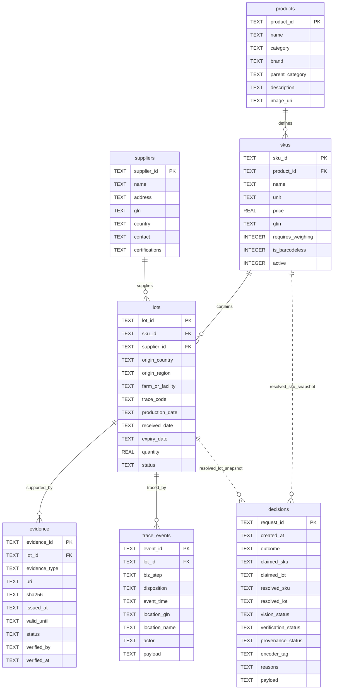

# Sơ đồ 7 bảng dữ liệu quan hệ

Nguồn hiện thực: `rpv/domain/schema.sql`, truy cập bằng
`rpv/provenance/repository.py`. Quan hệ có khóa ngoại được SQLite kiểm tra;
tham chiếu trong bảng quyết định là snapshot để giữ lịch sử khi danh mục đổi.

| Bảng | Vai trò | Ràng buộc và chỉ mục |
|---|---|---|
| suppliers | Nhà cung cấp, địa chỉ, GLN và thông tin khai báo | PK supplier_id |
| products | Khái niệm sản phẩm/nhóm hàng | PK product_id |
| skus | Đơn vị danh mục bán tại POS, mã nối bank thị giác | FK product_id; chỉ mục product/GTIN; giá hữu hạn không âm |
| lots | Lô riêng của SKU, nguồn gốc, ngày và trạng thái | FK SKU/supplier; CHECK status; chỉ mục SKU/status |
| evidence | Chứng từ từng lô, hash, người và thời điểm xác minh | FK lot_id; chỉ mục lot; ngày hiệu lực kiểm tra khi quyết định |
| trace_events | Nhận hàng/kiểm tra/bán hàng theo lô | FK lot_id; chỉ mục lot |
| decisions | Snapshot quyết định và đầu vào đối chiếu | Chỉ mục created_at/outcome; không FK tới SKU/lô để giữ lịch sử |

Sơ đồ rút gọn các trường phụ; schema.sql là nguồn đầy đủ. `certifications`,
`payload`, `reasons`, `messages` lưu JSON trong TEXT. `decision_state`,
`audit_notes.decision_inputs` và thời gian thị giác/policy được lưu trong
`decisions.payload`, không cần thay schema/migrate DB đang có. API trả thêm
`timings_ms.total`; tổng thời gian gồm bước ghi nhật ký nên chỉ biết sau đó.

Audit JSONL là artifact riêng ngoài 7 bảng. SQLite bật foreign_keys, WAL
và timeout; không tuyên bố DB transaction và file audit là một transaction
nguyên tử. Nếu ghi DB thành công mà ghi audit thất bại vẫn có thể xuất hiện
chênh lệch; cần cơ chế outbox/recovery riêng nếu triển khai production.
Hash chain hiện chưa có nơi neo head độc lập, không phát hiện việc cắt
đuôi hoặc viết lại toàn bộ log; trình bày giới hạn này trong Q4.
