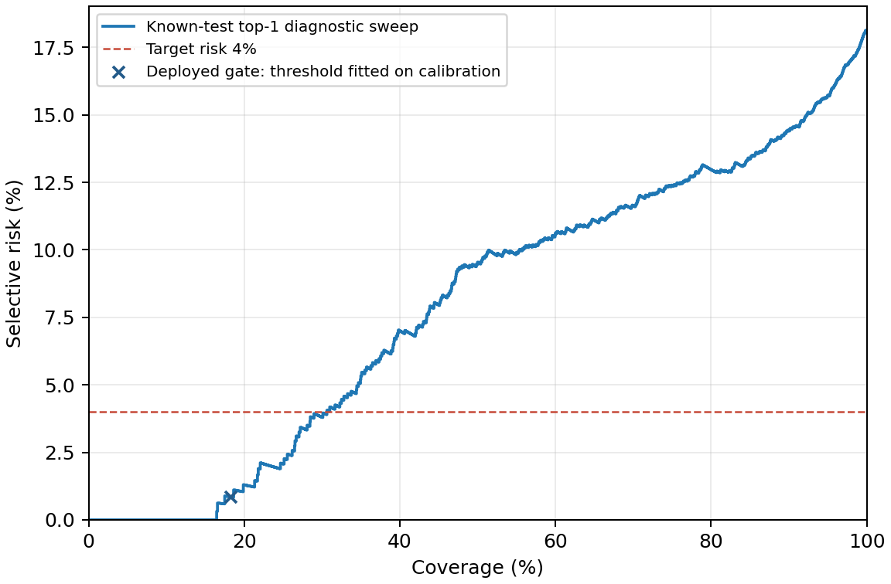

# Báo cáo đánh giá hệ thống RPV

- Thời điểm: 2026-10-19T14:56:34+00:00
- Encoder: `dinov2_vits14_s336_90f15cb97276985d_proj384_35d5872bc9167e3c_tta0_prototype_hs96w0.3_v1`
- Backbone: `vits14` · dim 480 · ảnh 336px · thiết bị `cuda` · projection head: `projection_head.pt`
- k-shot: 2 · alpha: 0.1 · TTA: False
- Dữ liệu: `data\dataset_v2`
- Protocol: `known_unknown_70_30_v1` · dataset fingerprint: `dc420dd70c2db61562551644f187199d91f5bf7d179efabc5ae11bc231118e93`

## 1. Phân chia dữ liệu

| Hạng mục | Giá trị |
|---|---|
| protocol | known_unknown_70_30_v1 |
| n_train_images | 2878 |
| n_validation_images | 1887 |
| n_known_classes | 17 |
| n_train_classes | 17 |
| n_novel_classes | 7 |
| n_support_images | 34 |
| n_calib_images | 1915 |
| n_test_images | 1927 |
| n_unknown_calib | 0 |
| n_unknown_test | 4200 |
| n_novel_support | 35 |
| n_novel_query | 836 |

> Prototype dựng từ support; ngưỡng chọn trên calib; số liệu đo trên test. Lớp novel chưa từng tham gia học biểu diễn.

## 2. Nhận diện (closed-set, đo trên test)

| Metric | Giá trị |
|---|---|
| Accuracy toàn danh mục | 81.89% |
| Macro-F1 toàn danh mục | 0.8183 |
| Macro-F1 (gồm lớp 'unknown') | 0.6390 |
| Số ảnh test | 1927 |

## 3. Open-set (khả năng nói "không biết")

| Metric | Giá trị |
|---|---|
| Ngưỡng toàn cục (chọn trên calib) | 0.8709 |
| Known recall | 86.77% |
| Unknown reject rate | 70.29% |
| False accept rate (hàng lạ bị nhận) | 29.71% |
| AUROC | 0.8641 |
| Score OOD | energy |
| FPR @ 95% TPR | 63.38% |

## 4. Dự đoán có kiểm soát rủi ro (conformal / selective)

| Metric | Giá trị |
|---|---|
| Tỉ lệ hệ thống chủ động không kết luận | 81.79% |
| Coverage chứa nhãn đúng | 93.36% |
| Coverage chứa nhãn đúng sau gate OOD | 82.20% |
| Kích thước tập trung bình | 1.8531 |
| Accuracy của câu trả lời tự động sau các gate | 99.15% |
| Hàng lạ bị từ chối đúng | 70.29% |
| Hàng lạ được trả lời tự động | 0.52% |
| Hàng lạ chuyển nhân viên (OOD hoặc mơ hồ/risk) | 99.48% |
| Coverage tại rủi ro 1% | 18.63% |
| Coverage tại rủi ro 5% | 34.67% |
| Coverage tại rủi ro 10% | 55.73% |
| Phân bố trạng thái | `{'ambiguous': 1321, 'match': 351, 'unknown': 255}` |

Đường cong top-1 và điểm gate vận hành dùng hai quy tắc chọn lọc khác nhau; CSV lưu toàn bộ ngưỡng thực nghiệm.

### Ngưỡng vận hành khóa trên known-calibration

- Rủi ro mục tiêu: 4.00%; coverage known-test: 18.21%; risk known-test: 0.85%.
- Trên known + unknown: coverage 6.09%; risk 6.70%.
- Đạt mục tiêu trên known-test: True. Không có câu trả lời thì risk chưa xác định, không coi là đạt.
- Coverage tại 1/5/10% trên đường cong chỉ là mô tả test; không chọn lại ngưỡng vận hành từ test. Ràng buộc calibration là thực nghiệm, chưa bảo đảm risk dân số.

## 5. Kiểm chứng lời khai (ảnh + SKU khai báo)

| Metric | Giá trị |
|---|---|
| Số cặp thật / cặp giả mạo | 1927 / 1927 |
| FAR (chấp nhận lời khai sai) | 0.00% |
| FRR (từ chối lời khai đúng) | 81.94% |
| EER | 6.07% |
| AUROC | 0.9816 |
| FAR với SKU sai gần nhất | 0.16% |

FAR ở đây thuộc verifier, chưa phải tỷ lệ policy cho phép thanh toán.

## Nhận diện lớp unknown sau khi đăng ký few-shot

| k-shot | Số query | Accuracy | Macro-F1 |
|---|---|---|---|
| 1 | 836 | 50.12% | 0.4878 |
| 2 | 836 | 59.21% | 0.6532 |
| 3 | 836 | 58.85% | 0.6548 |
| 5 | 836 | 68.18% | 0.7477 |

Pooled known conformal calibration transferred to novel classes; no class-conditional guarantee for novel. Energy/risk gates disabled because the catalog changed.

## 6. Hiệu chỉnh

- Ngưỡng riêng theo lớp: 17 SKU; dùng ngưỡng toàn cục: 0 SKU.
- Số liệu trên calib: `{'known_recall_on_calib': 0.8, 'unknown_reject_rate_on_calib': 0.0, 'target_known_recall': 0.8, 'n_known_calib': 1915, 'n_unknown_calib': 0, 'risk_calibration': 'six_extra_cal', 'n_extra_development': 3014}`
- CẢNH BÁO: Ngưỡng chỉ được chọn từ known-calib. Khả năng từ chối hàng ngoài danh mục phải được đánh giá trên unknown-test độc lập; không đưa unknown-test vào hiệu chỉnh.

## 7. Kịch bản nghiệp vụ end-to-end

Đạt 9/12 kịch bản (75.00%).

| Kịch bản | Mong đợi | Thực tế | Trạng thái quyết định | Kết quả | Mã lý do |
|---|---|---|---|---|---|
| happy_path | allow | assist | abstain | FAIL | VISION_AMBIGUOUS |
| missing_lot | assist | assist | provenance_exception | PASS | VISION_OK, PROVENANCE_MISSING |
| missing_evidence | assist | assist | provenance_exception | PASS | VISION_OK, PROVENANCE_INCOMPLETE |
| pending_evidence | allow_warning | assist | abstain | FAIL | VISION_AMBIGUOUS, PROVENANCE_PENDING |
| expired_lot | block | block | abstain | PASS | VISION_AMBIGUOUS, LOT_EXPIRED |
| recalled_lot | block | block | abstain | PASS | VISION_AMBIGUOUS, LOT_RECALLED |
| ticket_switch | block | assist | abstain | FAIL | VISION_AMBIGUOUS |
| unknown_item | assist_or_block | assist | abstain | PASS | VISION_UNKNOWN |
| imported_missing_customs | assist | assist | abstain | PASS | VISION_AMBIGUOUS, PROVENANCE_INCOMPLETE |
| same_sku_different_lot | block | block | abstain | PASS | VISION_AMBIGUOUS, LOT_EXPIRED |
| expired_certificate | assist | assist | abstain | PASS | VISION_AMBIGUOUS, PROVENANCE_EXPIRED, PROVENANCE_INCOMPLETE |
| lot_sku_conflict | block | block | abstain | PASS | VISION_AMBIGUOUS, LOT_SKU_CONFLICT |

Chấp nhận tự động sai trong kịch bản kiểm soát: image-only 2; full-policy 0.
Đây là số ca mô phỏng, chưa phải tỷ lệ lỗi ngoài quầy.

## 8. Phân tích lỗi

Cặp nhầm lẫn hay gặp nhất:

| Nhãn thật | Nhãn dự đoán | Số ca |
|---|---|---|
| Cà chua hồng | Cà chua tim bò | 92 |
| Táo Red Delicious | Táo Spartan | 53 |
| Táo Spartan | Táo Ligol | 41 |
| Táo Red Delicious | Hành tây tím | 32 |
| Táo Ligol | Táo Spartan | 17 |
| Cà chua tim bò | Táo Red Delicious | 9 |
| Táo Spartan | Cà chua bi vàng | 7 |
| Cà chua hồng | Rau xà lách xanh | 6 |
| Cà chua tim bò | Táo Ligol | 6 |
| Bắp ngô | Cà rốt | 5 |

SKU có recall thấp nhất (ưu tiên bổ sung ảnh mẫu):

- `Táo Red Delicious`: 15.24%
- `Táo Spartan`: 39.66%
- `Cà chua hồng`: 52.99%
- `Táo Ligol`: 79.59%
- `Cà chua tim bò`: 82.14%
- `Xoài`: 88.46%
- `Táo Granny Smith`: 92.38%
- `Bắp ngô`: 94.21%

## Cảnh báo về cách đọc số liệu

- Ngưỡng chỉ được chọn từ known-calib. Khả năng từ chối hàng ngoài danh mục phải được đánh giá trên unknown-test độc lập; không đưa unknown-test vào hiệu chỉnh.

## Giới hạn phải nêu trong luận văn

- Hệ thống KHÔNG suy đoán xuất xứ từ hình ảnh. Kết luận nguồn gốc luôn xuất phát từ hồ sơ lô và chứng từ; thiếu chứng từ thì trạng thái là "chưa xác minh".
- Số liệu trên dữ liệu mô phỏng chỉ để kiểm chứng pipeline. Kết quả đưa vào luận văn phải đo trên ảnh thật thu tại quầy, nhiều ngày và nhiều điều kiện sáng.
- Chưa xử lý chống giả mạo (ảnh in, ảnh trên màn hình điện thoại) và chưa xử lý nhiều vật thể trong một khung hình.
- Dữ liệu từ nguồn cộng đồng chỉ mang tính tham khảo, không có giá trị chứng từ.